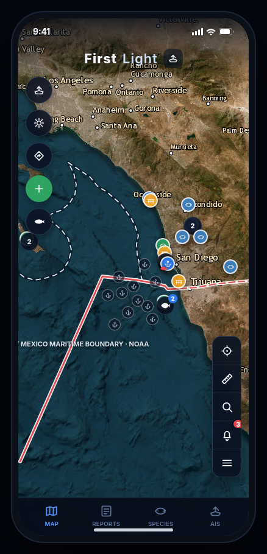

# Slugg Fishing

Slugg Fishing is an early web preview for a San Diego fishing app. The aim is to help people fishing around San Diego Bay see where fish are showing up, check the weather before they go, and sort out where to fish.

The screen you can run today is a single HTML page dressed as a phone. The wordmark on that screen is **First Light**, a working title stored in [`app/site.config.js`](app/site.config.js). This repository is the Slugg Fishing project, maintained by Jay Minakhom.

It is not a released app. It does not have accounts, a user base, or a hosted database. Counts you see on the profile and on spot cards are sample numbers written into the page.



## Current features

What follows is what `app/index.html` does when you serve it. Anything the project is meant to do later is under [Roadmap (planned)](#roadmap-planned).

**Map.** A Leaflet map opens on the San Diego coast using Esri satellite imagery. Pins mark a fixed set of harbors, piers, coastal spots, and lakes, plus 11 offshore waypoint numbers. Lines drawn from NOAA coordinates show the 12 nautical mile territorial sea and the U.S./Mexico maritime boundary. A separate land-border line is labeled as illustrative. The menu can hide spots, piers, lakes, bays, and offshore marks.

**Sample catch marks.** The map and the Reports tab show catch reports seeded in the browser (names such as "John D." and "Tommy T."). They are not a live community feed. Posting a catch keeps that report in the page until you reload. Privacy choices are Exact, General (about 1 km), or Zone only. In mock mode the page stores an offset in memory and only draws the display point. Nothing is sent to a server unless you later fill in `backend` in `app/site.config.js`.

**Species.** The Species tab lists 30 San Diego-area species with a search box, a season note, and a short limit summary. Bag limits, seasons, fish-ID notes, and a list of San Diego County marine protected areas open from Regulations. Those pages tell you to verify with California Department of Fish and Wildlife. They are not the official regulation book.

**Weather on screen.** The Conditions screen loads live numbers from public APIs:

- Open-Meteo for air temperature, wind, humidity, UV, pressure, visibility, swell, wave height, sea-surface temperature, and current near Point Loma
- NOAA CO-OPS tide predictions for station 9410170 (San Diego)
- NWS coastal waters forecast product CWF/SGX, and active alerts at a fixed point (32.7, -117.4)

Spot and waypoint pages load Open-Meteo wind, swell, and water temperature for that mark. The spot page's tide line stays a labeled sample ("3.2 ft"), even when the Conditions tide tab has been replaced with NOAA predictions. Wind and sea-surface overlays on the map are live Open-Meteo grids you turn on from the menu. The chlorophyll control is a color wash labeled as a sample, not a satellite layer.

**Other controls that work in the page.** Search across the built-in spots, waypoints, and species. Favorites for this browser session. A distance tool in nautical miles. Browser geolocation and a track line that exists until you start a new track or reload. Shore and lake spots can open Google Maps; offshore marks refuse directions and say they are not for navigation. Copy on a waypoint copies the coordinates and shows the same warning. An AIS screen plots 40 generated boats with made-up names. It is not a vessel feed.

**Profile.** A sample angler, Tommy Tran of San Diego, with placeholder catch, spot, follower, and following counts. Edit Profile changes the name and home port until reload. Premium, downloaded maps, and the gear icon open a short message. They do not bill anyone or download a chart pack. The three notifications are static sample text.

**Backend files, not a running backend.** `supabase/migrations/` is a Postgres/PostGIS schema for reports, location privacy, moderation, and GPS tracks. No Supabase project is connected. `BACKEND_CONFIG` defaults to `mode: 'mock'`.

## Run it locally

From the repository root:

```bash
python3 -m http.server 8080
```

Open [http://localhost:8080/app/](http://localhost:8080/app/).

Serve the folder over HTTP. A `file://` address often blocks the weather fetches and the location prompt. There is no install step and no package.json.

The optional database is separate from the preview. It needs PostgreSQL 15 or newer with PostGIS. The local shim in `supabase/tests/00_local_shim.sql` is for plain Postgres only. Do not run that shim on a Supabase project.

```bash
createdb offingcue_test
psql -d offingcue_test -c "alter database offingcue_test set search_path = public, extensions, app;"
psql -d offingcue_test -v ON_ERROR_STOP=1 -f supabase/tests/00_local_shim.sql
for f in supabase/migrations/*.sql; do psql -d offingcue_test -v ON_ERROR_STOP=1 -f "$f"; done
```

That database is not wired to the page until `backend.mode` in `app/site.config.js` is `supabase` and the URL and anon key are set.

## Use it as a template

The preview is one page plus a config file, so a shop or a guide service can fork it and swap the brand without restyling the layout.

1. Fork the repository.
2. Edit [`app/site.config.js`](app/site.config.js). That file documents each field. It covers the wordmark, document title, colors, region label, map center, distance origin, demo profile, official links, and the empty backend block.
3. Replace the San Diego content still living in `app/index.html`: `ZONES`, `WAYPOINTS`, `CATPINS`, `SPECIES_FULL`, `MPAS`, and the `seed(...)` sample reports. Read the comments in `site.config.js` before moving those arrays. They are the local fishing content, not the brand chrome.
4. Keep the warnings. Offshore coordinates are not for navigation, and regulation blurbs are not a substitute for the agency site you link to.
5. Do not commit secrets. Leave `supabaseAnonKey` empty, or set a public anon key only in an environment you control. Do not add a service-role key.

`scaffold/` is an older SwiftUI sketch with a different color set. It is not what the browser runs. `preview/offingcue-preview.html` is an earlier desktop-style preview under the codename OffingCue. `handoff/` is internal planning notes from July 2026.

## Project status

Early preview. One maintainer (Jay Minakhom). There is no release, no hosted service, and no published user count. Sample profile stats and sample reports are part of the page so the layout has something to show.

The UI is a phone frame with four tabs: Map, Reports, Species, and AIS. A menu opens waypoints, conditions, profile, regulations, and favorites.

## Roadmap (planned)

These are goals, not features. The current page does not do them.

- **Find fish in San Diego Bay.** The map is a wider coastal and inland preview: offshore marks, harbors, piers, Mission Bay, and a few lakes, with sample report pins. It does not locate fish in San Diego Bay, and it does not rank water by where fish are.
- **Best times to fish from the weather.** Conditions are displayed, and each sample spot has a fixed "Best Time" string such as "Morning" or "Dawn". Nothing scores a tide, wind, or swell and turns that into a recommended hour.
- **Coordinate where to go.** There is no shared plan, no invite, and no way for two people to agree on a spot. The catch form and the favorites list stay in one browser session.
- **A real report feed.** Human review is described in the form and in the SQL migrations. The page does not send reports to a moderator, and approved rows on screen are the seed data plus what you submitted locally.
- **Live AIS, saved tracks, offline charts, and photos.** Boats are generated in the page. Tracks disappear on reload. The photo buttons do not open a camera or strip EXIF. The offline-pack row does not download anything.
- **Accounts and payments.** The Premium row is a label and a toast. There is no checkout.

## Notices

Waypoint numbers and coordinates are public-reference samples pending verification. They are not for navigation.

Fishing rules on the species screens are summaries with a date of whatever was typed into the file. California, federal, and Mexican rules change. Use the agency links in the Regulations tab.

Weather tiles mix live model guidance (Open-Meteo) with official NOAA and NWS products where the caption says so. Model output is not a marine forecast you should navigate by.

## License

[MIT](LICENSE). Copyright 2026 Jay Minakhom.

See [CONTRIBUTING.md](CONTRIBUTING.md) and [CODE_OF_CONDUCT.md](CODE_OF_CONDUCT.md).
